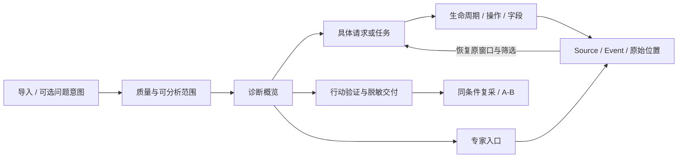

# 03 · UI/UX 与高保真原型说明

[打开可点击原型](prototype/index.html)。全部请求、数值与结论都是明确标记的合成设计数据；不解析用户文件，不开放现有实验 flags，不替代当前产品运行截图。

本文件复用前期 UI 设计。原型为历史合成演示，不是完整生产功能清单；专家占位页面须以 311 项矩阵为实施保护依据。条形图的 start/end/origin 仅验证演示几何，生产生命周期及 BEGIN/END 配对事实仍需 P0 实施和真实证据验证。

## C1 的页面关系

首层采用“连接被重置，两个请求没有完成”，详情仍使用同一问题引用；工程师增加 source ID、终点、操作 dt 和原始字段。角色不驱动第二套结论。左侧专家导航可随时直达，按来源展示，不把所有模块挤到首屏。

## 视觉规范

石墨证据工作台：系统字体，正文14px；标题18–24px；等宽用于错误码、ID和原始字段。顶部64px，1px边界，8–12px圆角，避免 Hero、玻璃、彩色阴影。绿色实底仅主操作；筛选、返回、清除为中性边框；危险动作边框/文字表达；选中态用文字与边界，严重性同时有文本标签。

深色背景 #0C0E12 / 面板 #161A21；浅色背景 #F5F5F7 / 白面板。UI tokens 对接既有 theme，而非创建第二套生产主题。原型 CSS 独立，只服务评审。

| 尺寸 | 列表/详情关系 | 信息保留 |
|---|---|---|
| 1440×900 | 184px 导航；工作区列表+约40%详情 | 列表、生命周期和字段同时可见 |
| 1280×800 | 166–184px导航；表格内部横向滚动 | 不截断错误码访问，详情可滚动 |
| 1024×768 | 156px导航；详情覆盖工作区 | 背景列表状态保留，Esc返回 |

不以移动端为发布门槛。长 URL 表格可省略视觉宽度，但可进入本地详情看到完整值；脱敏导出另走允许字段。

## 页面与关键状态

| 界面 | 正常 | 必须设计的非正常状态 |
|---|---|---|
| 导入 | 可选意图、直接选文件、阶段进度、质量摘要 | 截断、损坏、格式不支持、取消、替换会话、Worker不可用 |
| 概览 | 主事实、影响、依据、未知、下一步 | 无支持异常、弱证据、冲突、仅部分能力 |
| 请求 | 筛选/排序、选中、高亮、生命周期 | 无结果、目标被筛掉、请求未闭合、内部失败后成功 |
| 证据 | source/event/params/原始偏移 | 不存在、已释放、跨来源歧义、不能自动对齐时间 |
| Trace | 已观察任务/渲染与窗口 | 缺profile/交互/帧；不能将缺失呈现0 |
| Combined/A-B | 独立来源、关联理由、差异 | 重复URL、重定向、错时、弱关联、未匹配 |
| 行动 | 命题、角色、前提、记录与回退 | 无变化不排除原因；改善不确认根因；变差回退 |
| 交付 | 脱敏预览与本地下载 | 不含原始日志；失去原文件后的引用不可解析 |

原型可直接体验：来源切换、问题意图、质量状态切换、诊断→证据、筛选/排序、选中请求、原始事件面板、关闭/Esc恢复、Trace缺失态、Combined弱关联、A/B不可比、验证四种结果、深浅主题与脱敏演示下载。导入页只显示演示会话，不读取文件。

## 交互细则

1. 导航状态按会话+来源保存。证据跳转只临时绕过必要筛选，不永久重置整个列表。
2. 打开详情保存触发元素；Esc只关闭顶层详情，不清除选择/窗口，关闭后回到触发按钮。再次打开保持同一请求。
3. 切换文件清理旧会话；普通关闭详情不释放文件。原型保存的是演示状态，生产须用 session/revision 校验。
4. 时间窗口携带来源时钟。跨 HAR/NetLog 映射须显示依据与不确定性；Trace 不默认加入公共横轴。
5. 排序“生命周期最长”仅对有定义跨度排序；未闭合显示≥下界及排序口径，不假装精确完整。
6. 键盘可用Tab/Enter，表格请求入口为button，面板有名称、焦点与Escape行为。颜色之外同时标“失败/完成/未完成”。

## 原型评审脚本

在三尺寸、双主题各执行：

- 从概览“查看请求证据”进入失败请求；修改搜索与排序；打开原始事件再Esc；确认搜索、排序与选中仍在。
- 用筛选排除目标，跨页点击证据；看临时显示提示；返回原结果集合。
- 切到HAR等待响应慢；核对自报指标不求和。切到Trace缺profile，核对未显示函数零耗时。
- 记录无变化/改善/变差；核对解释边界和回退。下载演示报告，检查仅允许字段。
- 放大到200%，用键盘完成主路径；检查可滚动、无遮挡、焦点可见。

此脚本目前像素验收 not-run。未能确认 Edge 自动化可避开钥匙串，因此不启动相关路径；使用结构与DOM交互检查仅证明原型行为，不声称浏览器视觉已通过。
